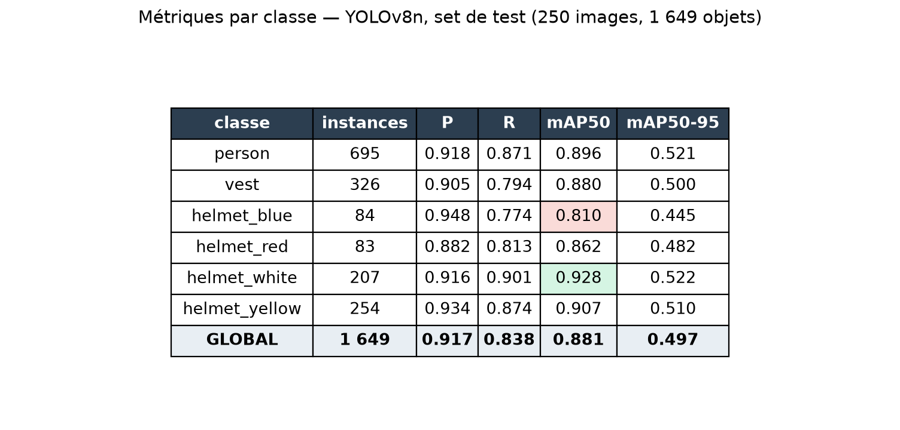
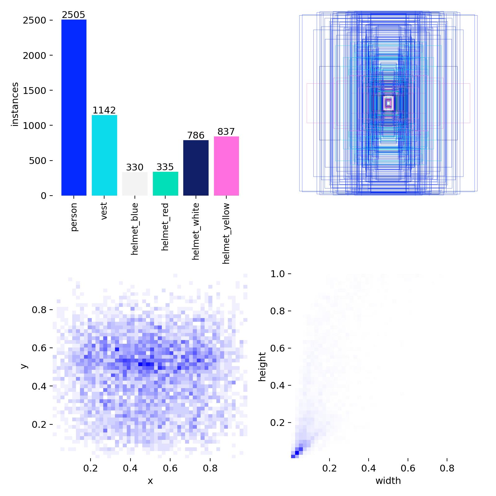
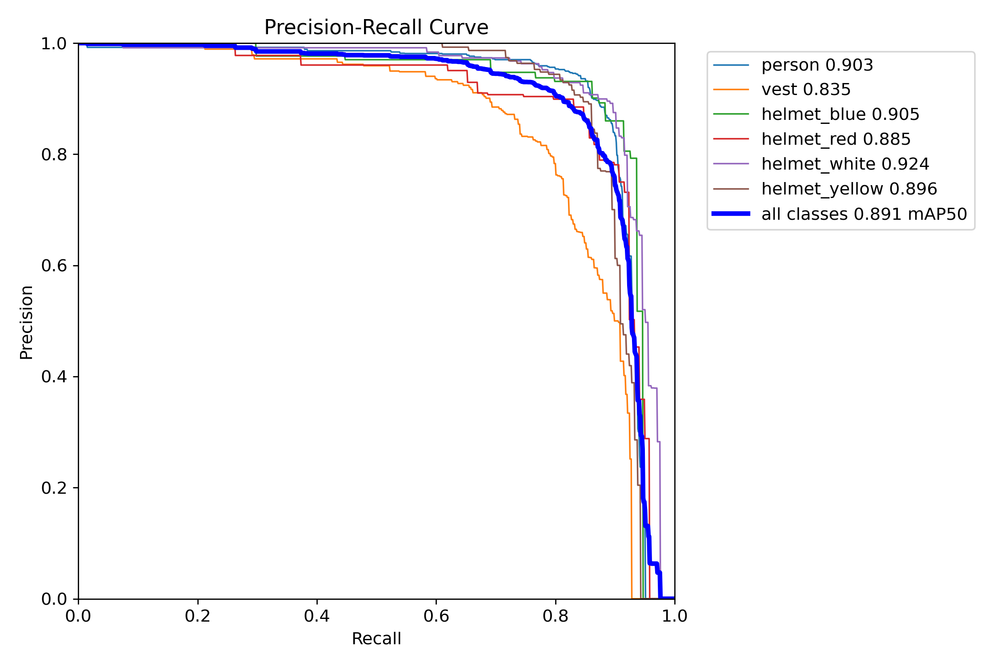
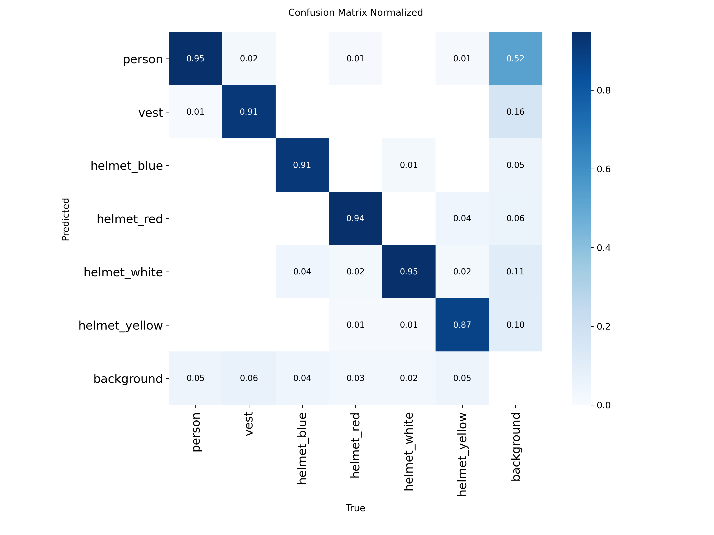

# Construction Site PPE Detection — YOLOv8

Six-class personal protective equipment (PPE) detection on construction site images,
with end-to-end evaluation of the **full system** (the "worker without helmet" business
rule), not just the detector.

| | |
|---|---|
| **mAP50 (test)** | **0.881** |
| mAP50-95 (test) | 0.497 |
| Model | YOLOv8n — 3.13 M parameters, 8.6 GFLOPs |
| Inference | 4.7 ms/image (T4) · ~60–120 ms (CPU) |
| Classes | `person`, `vest`, `helmet_blue`, `helmet_red`, `helmet_white`, `helmet_yellow` |

---

## Context and approach

The dataset provides 1,330 images annotated in Pascal VOC (XML): 1,080 for training,
250 for testing. The initial goal was a PPE detector; the goal that actually became
measurable was: *"when the system flags a worker without a helmet, is it right?"*

That question shaped the project, and its answer is more nuanced than the mAP.




> Figures regenerated by `scripts/make_figures.py` from `best.pt` and `results.csv`, without
> retraining. Annotated sample images are not published (rights on the source images, see
> [docs/LICENCE_DONNEES.md](docs/LICENCE_DONNEES.md)).

---

## The dataset

1,330 images annotated in Pascal VOC, 6 classes, **9,209 objects** in total, split into
three disjoint sets:

| Split | Images | Objects | Role |
| --- | --- | --- | --- |
| **train** | 864 (65 %) | **5,935** | what the model learns from |
| val | 216 (16 %) | 1,625 | monitored during training |
| test | 250 (19 %) | 1,649 | opened once, at the very end |
| **total** | **1,330** | **9,209** | |

| class | objects (total) | share |
| --- | --- | --- |
| person | 3,887 | 42.2 % |
| vest | 1,784 | 19.4 % |
| helmet_yellow | 1,299 | 14.1 % |
| helmet_white | 1,195 | 13.0 % |
| helmet_red | 536 | 5.8 % |
| helmet_blue | 508 | 5.5 % |



> This figure is generated by Ultralytics **on the training split only** (864 images,
> 5,935 objects) — that is all the model sees while learning. The 9,209-object total above
> also includes the `val` (1,625) and `test` (1,649) splits, never used for training. Each
> class accounts for ~64 % of its own total, confirming a de facto stratified split.

The imbalance is **7.6 to 1** between `person` and `helmet_blue`. This is the mechanical
reason `helmet_blue` gets the lowest mAP50 (0.810): only 508 objects, some of them small.
No rebalancing was applied — with 63 epochs on 864 images, oversampling would mostly have
increased overfitting.

The median box size (0.13 × 0.20 of the image) set `imgsz=640`: below that, distant helmets
drop under 10 pixels after resizing.

---

## Results

### The detector

| Metric | Validation (216 img) | **Test (250 img)** |
|---|---|---|
| mAP50 | 0.891 | **0.881** |
| mAP50-95 | 0.507 | 0.497 |
| Precision | 0.895 | 0.917 |
| Recall | 0.833 | 0.838 |

| class | instances (test) | P | R | mAP50 | mAP50-95 |
|---|---|---|---|---|---|
| person | 695 | 0.918 | 0.871 | 0.896 | 0.521 |
| vest | 326 | 0.905 | 0.794 | 0.880 | 0.500 |
| helmet_blue | 84 | 0.948 | 0.774 | 0.810 | 0.445 |
| helmet_red | 83 | 0.882 | 0.813 | 0.862 | 0.482 |
| helmet_white | 207 | 0.916 | 0.901 | 0.928 | 0.522 |
| helmet_yellow | 254 | 0.934 | 0.874 | 0.907 | 0.510 |

**Validation → test gap: −1 mAP50 point.** The model generalises; early stopping converged
at epoch 63/100 and no curve shows overfitting.

### Post-processing: IoU and NMS

Two different mechanisms share the same metric, and confusing them is the most common
misreading of detection results.

**IoU (Intersection over Union)** measures how much two boxes overlap: the intersection
area divided by the union area. 0 means no overlap, 1 means identical boxes.

**NMS (Non-Maximum Suppression)** cleans up the detector's output. For one object, the
model emits dozens of slightly shifted boxes; NMS keeps the most confident one and
discards any box overlapping it above a threshold (`iou=0.6` passed to Ultralytics in
`scripts/evaluate.py`). Without it, five people in one image would yield forty boxes.

A second pass runs in `predict.py` (`deduplicate()`, line 91): beyond ordinary overlap, it
also drops boxes **nested** inside another (containment > 0.8). This catches the same person
detected twice — a "torso" box inside a "full body" box — and keeps the larger one, which
is the useful one for the PPE rule.

**IoU is also the evaluation criterion**, which explains this project's central number:

| Metric | Matching requirement |
|---|---|
| mAP50 | predicted and ground-truth boxes must overlap by **50 %** (IoU ≥ 0.5) |
| mAP50-95 | averaged over IoU thresholds 0.50, 0.55 … up to **0.95** |

mAP50-95 therefore demands near-pixel-perfect localisation. The 38-point gap between 0.881
and 0.497 is not a model weakness: it measures **localisation precision**, and it stays
uniform across all six classes (0.354–0.409). The model finds the right objects; the
annotated boxes are not tight enough to sustain an IoU of 0.9. That is the annotation
ceiling argued below, expressed in the metric's own terms.

### The system ("worker without helmet" rule)

Evaluated against the test annotations (93 real violations among 1,649 objects):

| `--conf-person` | TP | False alarms | Precision | Honest recall |
|---|---|---|---|---|
| 0.25 | 50 | 73 | 0.407 | 0.538 |
| 0.45 | 46 | 50 | 0.479 | 0.495 |
| 0.55 | 43 | 34 | **0.558** | 0.462 |

**Structural ceiling**: at `--conf-person 0.55`, 43 of the 93 real violations involve people
the detector never sees (116 annotated people undetected, 17 %). Even with a perfect rule,
the maximum recall of the system is **0.538**.


Confusions concentrate between helmet classes of **different colours**
(`helmet_blue` ↔ `helmet_white` above all), not between `person` and the rest: the detector
locates correctly, it is the colour it hesitates to settle on small objects.

| Precision-recall | Normalised matrix |
| --- | --- |
|  |  |


---

## Technical decisions, and why

| Decision | Quantified reason |
|---|---|
| **`imgsz=640`, never 416** | helmets measure 37–47 px; at 416 they drop to 24–31 px, below the stride-8 limit |
| **Pretrained `yolov8n.pt`** | only 864 images; `person` already exists in COCO → feature transfer |
| **Test set opened only once** | otherwise the measurement becomes a tuning knob: generalisation is no longer measured |
| **Per-class mAP is mandatory** | 7.6× imbalance (`person` 42 % vs `helmet_blue` 5.5 %); a global mAP hides weak classes |
| **Per-class thresholds** | errors do not cost the same: missing a person = unmonitored; inventing a helmet = a bare head declared protected |
| **15 % margin above the `person` box** | the model sometimes detects the body without the head; gains +0.08 precision |

### Why stop here

The gap between mAP50 (0.881) and mAP50-95 (0.497) is **38 points and stays uniform across
all 6 classes** (0.354 to 0.409), including `person` where the model is excellent. That
consistency points to an **annotation quality ceiling**, not a capacity limit: training more
would not improve localisation. The only remaining lever would be re-annotating all 1,330
images with tighter boxes.

---

## Installation

```bash
python -m venv .venv
source .venv/bin/activate        # Windows: .\.venv\Scripts\Activate.ps1
pip install -r requirements.txt
```

Check: `python scripts/check_env.py`.

## Usage

```bash
# 1. Pascal VOC XML -> YOLO format + reproducible split
python scripts/xml_to_yolo.py --src ./data/raw_dataset --dst ./datasets/ppe

# 2. dataset audit (imbalance, object size)
python scripts/dataset_stats.py --data ./datasets/ppe

# 3. visual check of annotations (before any training)
python scripts/verif.py --data ./datasets/ppe --split train --n 12

# 4. training (CPU for a smoke test, GPU for real work)
python scripts/train.py --cpu --epochs 2 --imgsz 320 --fraction 0.1 --name smoke
python scripts/train.py --gpu --epochs 100 --imgsz 640 --batch 16 --name ppe_v1

# 5. evaluation on the test set (only once)
python scripts/evaluate.py --weights runs/detect/ppe_v1/weights/best.pt --split test

# 6. threshold calibration
python scripts/calibrate.py --weights best.pt --data ./datasets/ppe --split val

# 7. inference + PPE business rule
python scripts/predict.py --weights best.pt --source ./images --rule --save

# 8. evaluate the rule against the annotations
python scripts/evaluate_rule.py --weights best.pt --data ./datasets/ppe --split test

# 9. regenerate all figures without retraining
python scripts/make_figures.py --weights best.pt --data ./datasets/ppe
```

---

## Structure

```
ppe-detection-yolo/
├── scripts/
│   ├── check_env.py         # environment diagnostics (torch, device, RAM)
│   ├── xml_to_yolo.py       # Pascal VOC -> YOLO conversion + reproducible split
│   ├── verif.py             # visual check of annotations (5 s)
│   ├── dataset_stats.py     # audit: imbalance, median box size
│   ├── shrink_dataset.py    # dataset reduction for upload (keeps labels)
│   ├── train.py             # training, --cpu / --gpu / --fraction presets
│   ├── evaluate.py          # per-class mAP on the test set
│   ├── calibrate.py         # optimal P/R/F1 thresholds, global and per class
│   ├── predict.py           # inference + PPE rule + per-class thresholds + NMS
│   ├── evaluate_rule.py     # evaluates the business rule against annotations
│   ├── make_figures.py      # regenerates every figure from best.pt
│   └── collect_figures.py   # sorts Kaggle run figures into docs/figures
├── configs/yolov8n-ppe.yaml # ultra-light variant (1.3 M params) for CPU
├── notebooks/               # ready-to-run Colab / Kaggle pipeline
├── docs/                    # results, dataset analysis, Kaggle guide, installation (FR)
└── tools/                   # Windows utilities (directory cleanup)
```

---

## Data and credits

The full dataset is not distributed in this repository (1,330 images, ~400 MB): the images
come from public stock photo libraries and are used for research purposes.

The **evaluation figures** (`docs/figures/`) are statistical charts: they contain no pixel
from the source images and are freely publishable. Annotated sample images can be
regenerated locally with `scripts/predict.py --save`.

The code and scripts are freely available under the MIT license. See
[docs/LICENCE_DONNEES.md](docs/LICENCE_DONNEES.md) for the dataset terms.

---

## Known limitations

1. **17 % of annotated people are not detected** — distant, small or partially occluded
   silhouettes. This is the limiting factor of the full system.
2. **The system is a pre-filter**, not autonomous monitoring: at `--conf-person 0.35`,
   one alert out of two is false.
3. **`vest` boxes too wide** in the original annotations (they extend down to the knees),
   which caps mAP50-95.

## Improvement paths

| Priority | Action | Cost | Expected gain |
|---|---|---|---|
| 1 | `imgsz=960` (high-resolution dataset required) | 1 h 30 GPU | +2 to 4 mAP50, and above all fewer missed distant people |
| 2 | `yolov8s` for comparison | 2 h GPU | +2 to 4 mAP50 |
| 3 | Re-annotate the `vest` boxes | weeks | +5 to 10 mAP50-95 |
| 4 | Dedicated helmet detector on person crops | days | improves the business rule |

**What would not work**: more epochs (early stopping at 63/100), class weights, more
augmentation (no overfitting), changing the optimizer.

---

## Further reading

Detailed documentation is written in French:

- [Detailed results at three levels](docs/RESULTATS.md)
- [Dataset analysis](docs/ANALYSE_DATASET.md)
- [Decisions and improvement paths](docs/PISTES_AMELIORATION.md)
- [Installation guide](docs/INSTALLATION.md)
- [Running the training on Kaggle](docs/GUIDE_KAGGLE.md)
