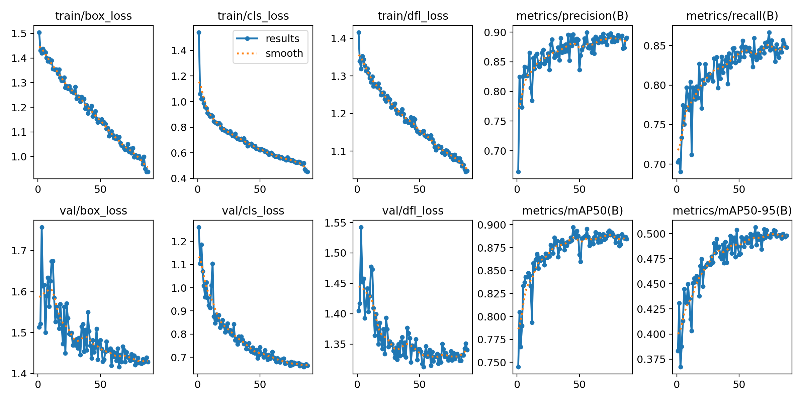
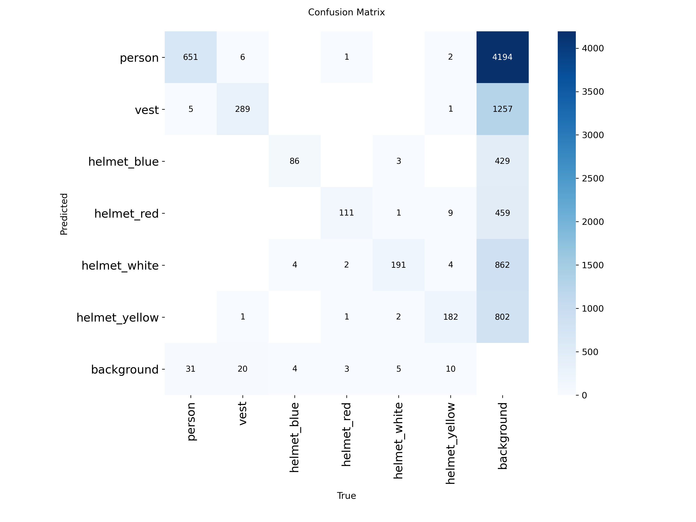
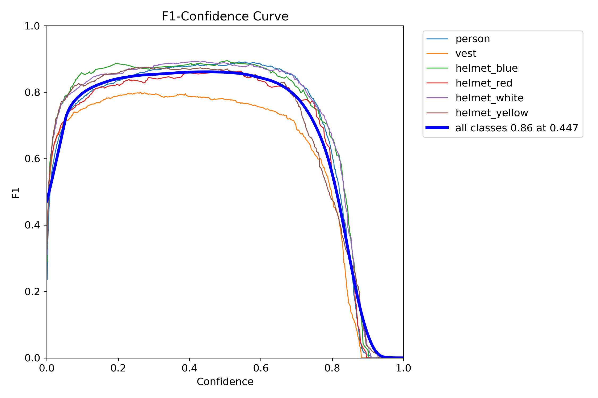

# Détection d'EPI sur chantier — YOLOv8

Détection de 6 classes d'équipements de protection individuelle sur des images de chantier,
avec évaluation du **système complet** (règle métier « personne sans casque »), pas seulement
du détecteur.

| | |
|---|---|
| **mAP50 (test)** | **0.881** |
| mAP50-95 (test) | 0.497 |
| Modèle | YOLOv8n — 3,13 M paramètres, 8,6 GFLOPs |
| Inférence | 4,7 ms/image (T4) · ~60–120 ms (CPU) |
| Classes | `person`, `vest`, `helmet_blue`, `helmet_red`, `helmet_white`, `helmet_yellow` |

---

## Contexte et démarche

Le dataset fournit 1330 images annotées en Pascal VOC (XML) : 1080 pour l'entraînement,
250 pour le test. L'objectif initial était un détecteur d'EPI ; l'objectif réel devenu
mesurable est : *« quand le système signale un ouvrier sans casque, a-t-il raison ? »*

C'est cette question qui a structuré le projet, et sa réponse est plus nuancée que la mAP.




> Figures regenerees par `scripts/make_figures.py` depuis `best.pt` et `results.csv`, sans
> reentrainement. Les images d'exemple avec photos ne sont pas publiees (droits sur les
> images source, voir [docs/LICENCE_DONNEES.md](docs/LICENCE_DONNEES.md)).

---

## Résultats

### Le détecteur

| Métrique | Validation (216 img) | **Test (250 img)** |
|---|---|---|
| mAP50 | 0.891 | **0.881** |
| mAP50-95 | 0.507 | 0.497 |
| Précision | 0.895 | 0.917 |
| Rappel | 0.833 | 0.838 |

| classe | instances (test) | P | R | mAP50 | mAP50-95 |
|---|---|---|---|---|---|
| person | 695 | 0.918 | 0.871 | 0.896 | 0.521 |
| vest | 326 | 0.905 | 0.794 | 0.880 | 0.500 |
| helmet_blue | 84 | 0.948 | 0.774 | 0.810 | 0.445 |
| helmet_red | 83 | 0.882 | 0.813 | 0.862 | 0.482 |
| helmet_white | 207 | 0.916 | 0.901 | 0.928 | 0.522 |
| helmet_yellow | 254 | 0.934 | 0.874 | 0.907 | 0.510 |

**Écart validation → test : −1 point de mAP50.** Le modèle généralise ; l'early stopping a
convergé à l'epoch 63/100 et aucune courbe ne montre de sur-apprentissage.

### Le système (règle « personne sans casque »)

Évaluée contre les annotations de test (93 violations réelles sur 1649 objets) :

| `--conf-person` | TP | Fausses alertes | Précision | Rappel honnête |
|---|---|---|---|---|
| 0.25 | 50 | 73 | 0.407 | 0.538 |
| 0.45 | 46 | 50 | 0.479 | 0.495 |
| 0.55 | 43 | 34 | **0.558** | 0.462 |

**Plafond structurel** : avec `--conf-person 0.55`, 43 des 93 violations réelles portent sur
des personnes que le détecteur ne voit jamais (116 personnes annotées non détectées, 17 %).
Même avec une règle parfaite, le rappel maximal du système est **0.538**.




---

## Les décisions techniques, et leurs raisons

| Décision | Raison chiffrée |
|---|---|
| **`imgsz=640`, jamais 416** | les casques mesurent 37–47 px ; à 416 ils tombent à 24–31 px, sous la limite de la stride 8 |
| **`yolov8n.pt` pré-entraîné** | 864 images seulement ; `person` existe déjà dans COCO → transfert de features |
| **Test set ouvert une seule fois** | sinon la mesure devient un réglage : on ne mesure plus la généralisation |
| **mAP par classe obligatoire** | déséquilibre de 7,5× (`person` 42 % vs `helmet_blue` 5,6 %) ; une mAP globale masque les classes faibles |
| **Seuils par classe** | les erreurs n'ont pas le même coût : rater une personne = non contrôlée ; inventer un casque = tête nue déclarée protégée |
| **Marge de 15 % au-dessus de la boîte `person`** | le modèle détecte parfois le corps sans la tête ; gagner +0,08 de précision |

### Pourquoi s'arrêter là

L'écart entre mAP50 (0.881) et mAP50-95 (0.497) est de **38 points et reste uniforme sur les
6 classes** (0.354 à 0.409), y compris `person` où le modèle est excellent. Cette constance
indique un **plafond de qualité d'annotation**, pas une limite de capacité : réentraîner
davantage n'améliorerait pas la localisation. Le seul levier restant serait de ré-annoter
1330 images.

---

## Installation

```bash
python -m venv .venv
source .venv/bin/activate        # Windows : .\.venv\Scripts\Activate.ps1
pip install -r requirements.txt
```

Vérification : `python scripts/check_env.py`.

## Utilisation

```bash
# 1. XML Pascal VOC -> format YOLO + split 80/20
python scripts/xml_to_yolo.py --src ./data/dataset_brut --dst ./datasets/ppe

# 2. audit du dataset (déséquilibre, taille des objets)
python scripts/dataset_stats.py --data ./datasets/ppe

# 3. contrôle visuel des annotations (avant tout entraînement)
python scripts/verif.py --data ./datasets/ppe --split train --n 12

# 4. entraînement (CPU pour un test fumée, GPU pour du sérieux)
python scripts/train.py --cpu --epochs 2 --imgsz 320 --fraction 0.1 --name smoke
python scripts/train.py --gpu --epochs 100 --imgsz 640 --batch 16 --name ppe_v1

# 5. évaluation sur le test set (une seule fois)
python scripts/evaluate.py --weights runs/detect/ppe_v1/weights/best.pt --split test

# 6. calibration des seuils
python scripts/calibrate.py --weights best.pt --data ./datasets/ppe --split val

# 7. inférence + règle métier EPI
python scripts/predict.py --weights best.pt --source ./images --rule --save

# 8. évaluation de la règle contre les annotations
python scripts/evaluate_rule.py --weights best.pt --data ./datasets/ppe --split test

# 9. régénérer toutes les figures sans réentraîner
python scripts/make_figures.py --weights best.pt --data ./datasets/ppe
```

---

## Structure

```
ppe-yolo/
├── scripts/
│   ├── check_env.py         # diagnostic environnement (torch, device, RAM)
│   ├── xml_to_yolo.py       # conversion Pascal VOC -> YOLO + split reproductible
│   ├── verif.py             # contrôle visuel des annotations (5 s)
│   ├── dataset_stats.py     # audit : déséquilibre, taille médiane des boîtes
│   ├── shrink_dataset.py    # réduction du dataset pour upload (garde les labels)
│   ├── train.py             # entraînement, presets --cpu / --gpu / --fraction
│   ├── evaluate.py          # mAP par classe sur le test set
│   ├── calibrate.py         # seuils optimaux P/R/F1, global et par classe
│   ├── predict.py           # inférence + règle EPI + seuils par classe
│   ├── evaluate_rule.py     # évalue la règle métier contre les annotations
│   └── make_figures.py      # régénère toutes les figures depuis best.pt
├── configs/yolov8n-ppe.yaml # variante ultra-légère (1,3 M params) pour CPU
├── notebooks/               # pipelines Colab / Kaggle prêts à l'emploi
├── docs/                    # résultats, analyse dataset, guide Kaggle, installation
└── tools/                   # utilitaires Windows (nettoyage d'arborescence)
```

---

## Données et crédits

Le dataset complet n'est pas distribué dans ce dépôt (1330 images, ~400 Mo) : les images
proviennent de banques d'images publiques, utilisées à des fins de recherche.

Quelques **images d'exemple annotées** sont incluses à titre de démonstration visuelle
(`docs/figures/exemples/`). Elles restent la propriété de leurs ayants droit respectifs et
ne sont pas redistribuées à des fins commerciales. Le code et les scripts sont fournis
librement. Voir [docs/LICENCE_DONNEES.md](docs/LICENCE_DONNEES.md).


## Limites connues

1. **17 % des personnes annotées ne sont pas détectées** — silhouettes lointaines, petites ou
   partiellement occultées. C'est le facteur limitant du système complet.
2. **Le système est un pré-filtre**, pas un contrôle autonome : à `--conf-person 0.35`,
   une alerte sur deux est fausse.
3. **Boîtes `vest` trop larges** dans les annotations d'origine (elles descendent aux genoux),
   ce qui bride la mAP50-95.

## Pistes d'amélioration

| Priorité | Action | Coût | Gain attendu |
|---|---|---|---|
| 1 | `imgsz=960` (dataset haute résolution requis) | 1 h 30 GPU | +2 à 4 mAP50, et surtout moins de personnes lointaines manquées |
| 2 | `yolov8s` en comparaison | 2 h GPU | +2 à 4 mAP50 |
| 3 | Ré-annoter les boîtes `vest` | semaines | +5 à 10 mAP50-95 |
| 4 | Détecteur dédié aux casques sur crops de personnes | jours | améliore la règle métier |

**Ce qui ne marcherait pas** : plus d'epochs (early stopping à 63/100), class weights,
plus d'augmentation (aucun sur-apprentissage), changer d'optimizer.
